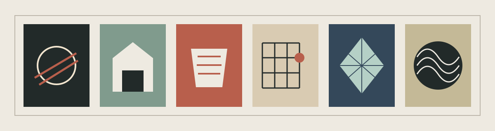
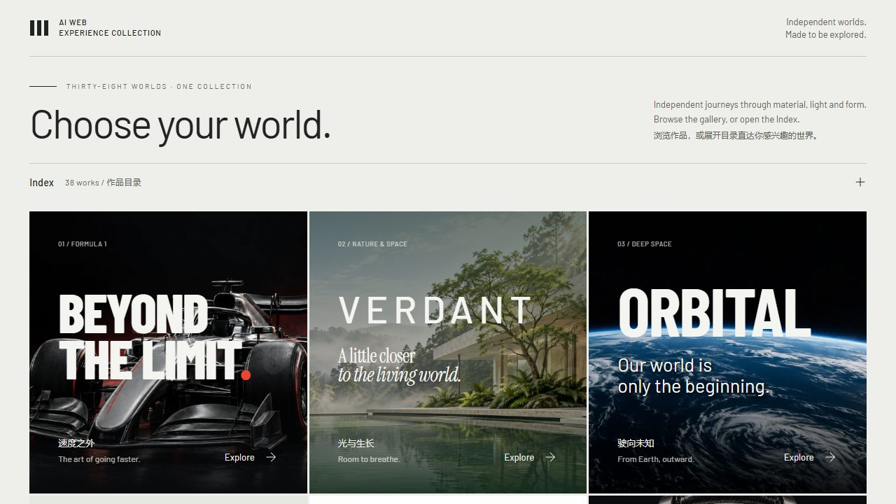

# AI Web Experience Collection

A curated entrance to 38 independent browser experiences about motion, material, light, engineering, craft, and perception. Each work has its own page, interaction, and visual identity.

[Enter the collection](https://seiya058904.github.io/ai-web-experience-collection/) · [Explore all works](#the-collection) · [Run locally](#run-locally)

*Original gallery illustration, not a screenshot.*

## Features

- **Explore separate worlds:** move from a mechanical watch to a jet engine, an architectural space, or a study of ink without keeping all experiences running at once.
- **Follow the subject:** individual works use their own motion, typography, imagery, interaction controls, and pacing.
- **Use the browser as the medium:** the collection combines CSS, SVG, Canvas, WebGL, and selected React/Three.js implementations as appropriate to each work.
- **Find your way back:** the collection provides a shared entrance and return navigation to independently loaded documents.
- **Choose supported alternatives:** individual works provide reading, still-view, reduced-motion, or Canvas alternatives where implemented; coverage differs by work.



*Actual Chromium capture of the local collection entrance.*

## The collection

The links below open published pages within this repository, not separate repositories. All 38 returned HTTP 200 when checked on October 27, 2026.

<details>
<summary>Browse all 38 experiences by subject</summary>

### Machines, energy, and motion

- [Beyond the Limit](https://seiya058904.github.io/ai-web-experience-collection/f1/) — Formula 1, speed, and racing engineering.
- [ORBITAL](https://seiya058904.github.io/ai-web-experience-collection/orbital/) — Rockets, orbital flight, and deep space.
- [CHRONOS](https://seiya058904.github.io/ai-web-experience-collection/chronos/) — Time inside an original mechanical watch.
- [FUSION](https://seiya058904.github.io/ai-web-experience-collection/fusion/) — An illustrative tokamak and confined plasma.
- [OPTIC](https://seiya058904.github.io/ai-web-experience-collection/optic/) — Light moving through a camera.
- [SILICON](https://seiya058904.github.io/ai-web-experience-collection/silicon/) — Semiconductor layers, lithography, and signal.
- [THRUST](https://seiya058904.github.io/ai-web-experience-collection/thrust/) — Air moving through a jet engine.
- [RESONANCE](https://seiya058904.github.io/ai-web-experience-collection/resonance/) — Vibration, sound, and opt-in audio interaction.

### Landscapes, architecture, and space

- [VERDANT](https://seiya058904.github.io/ai-web-experience-collection/verdant/) — Botanical landscapes, architecture, and spring light.
- [INTERVAL](https://seiya058904.github.io/ai-web-experience-collection/interval/) — Six connected studies of architectural space.
- [GLASSHOUSE](https://seiya058904.github.io/ai-web-experience-collection/glasshouse/) — Transparency, refraction, reflection, and space.
- [ATLAS](https://seiya058904.github.io/ai-web-experience-collection/atlas/) — Fuji and Fujiyoshida geography across scales.
- [PARALLAX](https://seiya058904.github.io/ai-web-experience-collection/parallax/) — Ten perspectives of an original sculpture.

### Craft, objects, and materials

- [GLAZE](https://seiya058904.github.io/ai-web-experience-collection/glaze/) — Fired ceramic surfaces, color, and light.
- [FORM](https://seiya058904.github.io/ai-web-experience-collection/form/) — Three authored furniture objects and their structure.
- [VEIL](https://seiya058904.github.io/ai-web-experience-collection/veil/) — Thread, fabric, folds, and transmitted light.
- [FACET](https://seiya058904.github.io/ai-web-experience-collection/facet/) — Six gemstone specimens and optical behavior.
- [LUTHIER](https://seiya058904.github.io/ai-web-experience-collection/luthier/) — A violin from silent wood to resonance.
- [CODEX](https://seiya058904.github.io/ai-web-experience-collection/codex/) — Paper, signatures, sewing, and bookbinding.
- [URUSHI](https://seiya058904.github.io/ai-web-experience-collection/urushi/) — Lacquer, curing, abrasion, and surface depth.
- [NIB](https://seiya058904.github.io/ai-web-experience-collection/nib/) — Ink, feed, capillary balance, and the written line.
- [DOSE](https://seiya058904.github.io/ai-web-experience-collection/dose/) — A hypothetical tablet, material and conceptual cutaway.
- [COUNTERFORM](https://seiya058904.github.io/ai-web-experience-collection/counterform/) — Variable typography, letterform anatomy and the shape of reading.
- [FERRUM](https://seiya058904.github.io/ai-web-experience-collection/ferrum/) — An original digital steel sculpture through six acts.
- [CREMA](https://seiya058904.github.io/ai-web-experience-collection/crema/) — Espresso pressure, porous flow, and crema.
- [CRAVE](https://seiya058904.github.io/ai-web-experience-collection/crave/) — Heat, browning, crust, steam, and appetite.

### Light, images, and memory

- [KAGE / VOID](https://seiya058904.github.io/ai-web-experience-collection/kage/) — A procedural sculpture of light and shadow.
- [INKSCAPE](https://seiya058904.github.io/ai-web-experience-collection/inkscape/) — Paper, water, pigment, and negative space.
- [AETERNA](https://seiya058904.github.io/ai-web-experience-collection/aeterna/) — Roman sculpture, marble, and museum memory.

### Deep time and visual order

- [MAGMA](https://seiya058904.github.io/ai-web-experience-collection/magma/) — Molten rock, cooling, fracture, and stone.
- [FOSSIL](https://seiya058904.github.io/ai-web-experience-collection/fossil/) — Burial, preservation, synthetic tomography, and archives.
- [GRID](https://seiya058904.github.io/ai-web-experience-collection/grid/) — One content set under twelve design systems.

### Messages, weather, and collectives

- [RELAY](https://seiya058904.github.io/ai-web-experience-collection/relay/) — A sentence, an uncertain route, and an original toy protocol.
- [SUPERCELL](https://seiya058904.github.io/ai-web-experience-collection/supercell/) — Airflow, section planes, and one illustrated storm.
- [PELAGIC](https://seiya058904.github.io/ai-web-experience-collection/pelagic/) — Living light, pattern, and encounter in the deep ocean.
- [BACKSTAGE](https://seiya058904.github.io/ai-web-experience-collection/backstage/) — A miniature theatre and the cues that keep it believable.
- [MURMURATION](https://seiya058904.github.io/ai-web-experience-collection/murmuration/) — Local rules, a traveling turn, and a flock you can change.
- [VAREN](https://seiya058904.github.io/ai-web-experience-collection/varen/) — Contemporary tailoring, garment details and a personal selection.

</details>

## Architecture and interpretation

The gallery links to separate HTML documents. Each experience owns its own runtime and cleanup; it is not an iframe carousel or a single page keeping every 3D scene alive. The shared build uses Vite and TypeScript alongside GSAP, Lenis, and selected React/Three.js modules.

Artistic interpretation is not a scientific measurement. ATLAS uses geographic sources with documented limits; FOSSIL uses authored synthetic tomography; CREMA's pressure is a narrative reference rather than a universal rule; DOSE is a hypothetical tablet, not a clinical product. VAREN's garment imagery is AI-generated and no products are offered for sale. Consult each work's documentation for its own evidence and caveats.

## Run locally

**Prerequisites:** Node.js 24 and npm.

```sh
npm ci
npm run dev
```

Open the URL printed by Vite. For the production project path and build verification:

```sh
npm test
npm run build -- --base=/ai-web-experience-collection/
npm run verify:build
npm run preview -- --port 4175 --strictPort --base=/ai-web-experience-collection/
```

`npm run verify` runs the standard tests, build, and build-reference verification. Verification is per work and integration surface: one successful scene does not establish quality across the collection.

## Project map

- [`pages/`](pages/) and [`collection/`](collection/) — the gallery, credits, and independent page entrances.
- [`experiences/`](experiences/) and [`public/`](public/) — work-specific implementations, media, fonts, models, and notices.
- [`docs/`](docs/) and [`provenance/`](provenance/) — design, source, research, and acceptance records.
- [`tests/`](tests/) and [`scripts/`](scripts/) — checks for models, routes, content, and build output.

Read [collection design](docs/collection/DESIGN.md), the relevant work's records, and [repository guidance](AGENTS.md) before changing a work's assets, lifecycle, or deployment.

## Rights and provenance

The collection is not universally MIT-licensed. Its root [LICENSE](LICENSE) reserves original material; supplied code, third-party software, media, fonts, models, and datasets retain their own terms. GLAZE, KAGE / VOID, CHRONOS, INTERVAL, and the supplied DOSE source have separately documented MIT permissions.

See [attribution](ATTRIBUTION.md), [public license notices](public/licenses.txt), [source records](provenance/README.md), and [About & Credits](https://seiya058904.github.io/ai-web-experience-collection/credits.html). Opt-in audio should not be described as autoplaying or as unrestricted audio assets.

Formula 1, F1, NASA, SpaceX, and other marks belong to their respective owners. This independent collection is unofficial and is not affiliated with or endorsed by them.
