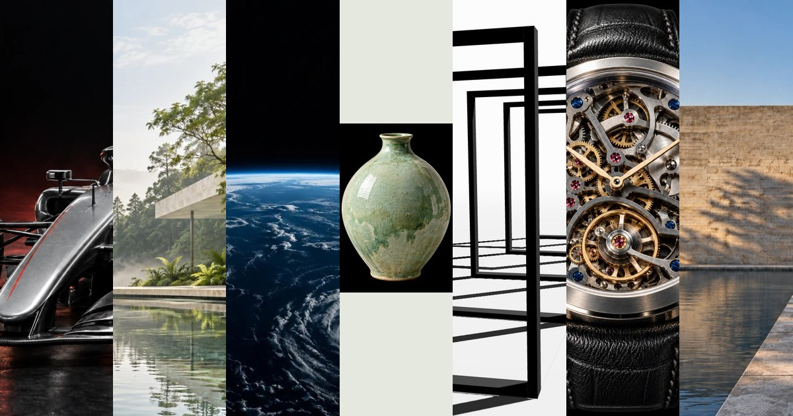
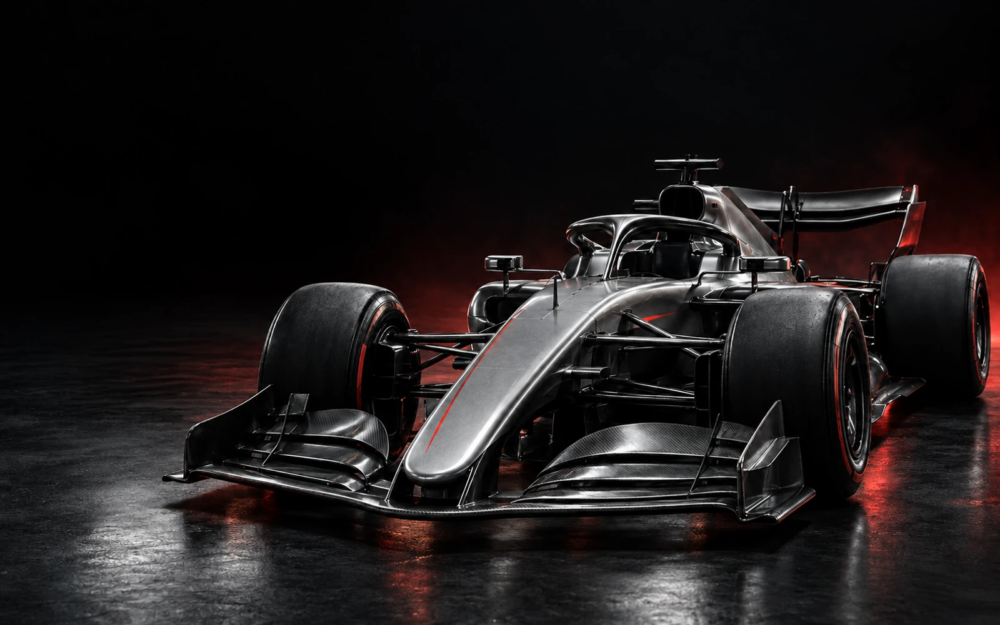
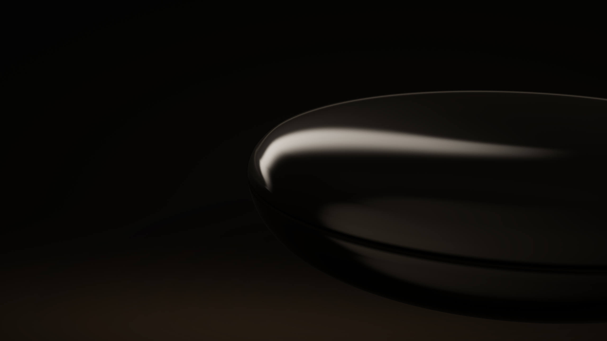

<h1 align="center">✦ AI Web Experience Collection</h1>

<p align="center"><strong>Thirty-eight worlds. Thirty-eight ways to experience the web.</strong></p>

<p align="center">
  A curated exhibition of cinematic, browser-native experiments in motion, matter,<br>
  light, engineering, craft, and visual perception.
</p>

<p align="center">
  <a href="https://seiya058904.github.io/ai-web-experience-collection/"><strong>↗ Enter the Collection</strong></a>
  &nbsp;·&nbsp;
  <a href="#find-your-world">✦ Where to Begin</a>
  &nbsp;·&nbsp;
  <a href="#the-complete-exhibition">🗂️ All 32 Works</a>
  &nbsp;·&nbsp;
  <a href="#built-as-independent-worlds">⚙️ Architecture</a>
  &nbsp;·&nbsp;
  <a href="#rights--provenance">📜 Credits</a>
</p>

<p align="center">
  <sub>32 INDEPENDENT EXPERIENCES &nbsp;·&nbsp; ONE CURATED ENTRANCE &nbsp;·&nbsp; FULL-DOCUMENT NAVIGATION</sub><br>
  <sub>SCROLL-DRIVEN NARRATIVES &nbsp;·&nbsp; WEBGL / CANVAS / SVG &nbsp;·&nbsp; DESKTOP + MOBILE</sub>
</p>

<p align="center">
  
  <br />
  <sub>The collection's own cover artwork, included in the published site.</sub>
</p>

---

> **The subject is different every time. The medium is always the browser.**
>
> A mechanical watch becomes a journey through time. A violin becomes a study of tension and sound. A sheet of paper becomes a living grid. These are not thumbnails of projects: each is a complete interactive work with its own pace, imagery, and visual identity.

<a id="find-your-world"></a>
## ✦ Find Your World

<table>
  <tr>
    <td width="50%" valign="top">
      <h3>🚀 Enter a Machine</h3>
      <p><sub>ENGINEERING · MOTION · PRECISION</sub></p>
      <p>Follow a rocket beyond Earth, pass through a camera's optics, or move inside a jet engine.</p>
      <p><strong><a href="https://seiya058904.github.io/ai-web-experience-collection/orbital/">ORBITAL ↗</a></strong> &nbsp;·&nbsp; <a href="https://seiya058904.github.io/ai-web-experience-collection/optic/">OPTIC ↗</a> &nbsp;·&nbsp; <a href="https://seiya058904.github.io/ai-web-experience-collection/thrust/">THRUST ↗</a></p>
    </td>
    <td width="50%" valign="top">
      <h3>🕰️ Study an Object</h3>
      <p><sub>CRAFT · MATERIAL · TIME</sub></p>
      <p>Explore a mechanical watch, a sewn book, or the layered surface of a lacquer vessel.</p>
      <p><strong><a href="https://seiya058904.github.io/ai-web-experience-collection/chronos/">CHRONOS ↗</a></strong> &nbsp;·&nbsp; <a href="https://seiya058904.github.io/ai-web-experience-collection/codex/">CODEX ↗</a> &nbsp;·&nbsp; <a href="https://seiya058904.github.io/ai-web-experience-collection/urushi/">URUSHI ↗</a></p>
    </td>
  </tr>
  <tr>
    <td width="50%" valign="top">
      <h3>◐ Enter a Space</h3>
      <p><sub>LIGHT · SHADOW · ARCHITECTURE</sub></p>
      <p>Walk through glass, approach a spatial sculpture, or look at Roman stone in a new light.</p>
      <p><strong><a href="https://seiya058904.github.io/ai-web-experience-collection/kage/">KAGE / VOID ↗</a></strong> &nbsp;·&nbsp; <a href="https://seiya058904.github.io/ai-web-experience-collection/glasshouse/">GLASSHOUSE ↗</a> &nbsp;·&nbsp; <a href="https://seiya058904.github.io/ai-web-experience-collection/aeterna/">AETERNA ↗</a></p>
    </td>
    <td width="50%" valign="top">
      <h3>🔠 Change the Rules</h3>
      <p><sub>TYPOGRAPHY · PERCEPTION · COMPOSITION</sub></p>
      <p>Watch one set of content become twelve different visual systems, or discover how perspective changes a form.</p>
      <p><strong><a href="https://seiya058904.github.io/ai-web-experience-collection/grid/">GRID ↗</a></strong> &nbsp;·&nbsp; <a href="https://seiya058904.github.io/ai-web-experience-collection/parallax/">PARALLAX ↗</a> &nbsp;·&nbsp; <a href="https://seiya058904.github.io/ai-web-experience-collection/inkscape/">INKSCAPE ↗</a></p>
    </td>
  </tr>
</table>

### What Connects Them?

**A material, a mechanism, or a question becomes an experience.** Each work has a distinct entrance, complete story, interaction model, and rendering lifecycle. The Collection itself stays a restrained gallery: visit a world, explore it, and return when you are ready.

## 🖼️ A Glimpse of the Collection

A small selection of the visuals already shipped with individual experiences. Each world has its own visual language, rather than sharing one generic gallery template.

<table>
  <tr>
    <td width="50%" align="center" valign="top">
      <a href="https://seiya058904.github.io/ai-web-experience-collection/f1/">
        
      </a>
      <br />
      <strong><a href="https://seiya058904.github.io/ai-web-experience-collection/f1/">F1 · Beyond the Limit →</a></strong>
      <br />
      <sub>Speed, precision, and racing engineering</sub>
    </td>
    <td width="50%" align="center" valign="top">
      <a href="https://seiya058904.github.io/ai-web-experience-collection/urushi/">
        
      </a>
      <br />
      <strong><a href="https://seiya058904.github.io/ai-web-experience-collection/urushi/">URUSHI · Layers of Time →</a></strong>
      <br />
      <sub>Craft, material, and the depth of lacquer</sub>
    </td>
  </tr>
</table>

<a id="the-complete-exhibition"></a>
## 🗂️ The Complete Exhibition — 32 Works

Each name below opens its published standalone page. The routes belong to this single collection, not to thirty-eight separate repositories.

### ⚙️ I. Machines, Energy & Motion

| Experience | Explore | Subject |
| --- | --- | --- |
| **Beyond the Limit** | [F1 ↗](https://seiya058904.github.io/ai-web-experience-collection/f1/) | Formula 1, speed, and racing engineering |
| **ORBITAL** | [Enter ↗](https://seiya058904.github.io/ai-web-experience-collection/orbital/) | Rockets, orbital flight, and deep space |
| **CHRONOS** | [Enter ↗](https://seiya058904.github.io/ai-web-experience-collection/chronos/) | Time inside an original mechanical watch |
| **FUSION** | [Enter ↗](https://seiya058904.github.io/ai-web-experience-collection/fusion/) | An illustrative tokamak and confined plasma |
| **OPTIC** | [Enter ↗](https://seiya058904.github.io/ai-web-experience-collection/optic/) | Light moving through a camera |
| **SILICON** | [Enter ↗](https://seiya058904.github.io/ai-web-experience-collection/silicon/) | Semiconductor layers, lithography, and signal |
| **THRUST** | [Enter ↗](https://seiya058904.github.io/ai-web-experience-collection/thrust/) | Air moving through a jet engine |
| **RESONANCE** | [Enter ↗](https://seiya058904.github.io/ai-web-experience-collection/resonance/) | Vibration, sound, and opt-in audio interaction |

### 🌿 II. Landscapes, Architecture & Space

| Experience | Explore | Subject |
| --- | --- | --- |
| **VERDANT** | [Enter ↗](https://seiya058904.github.io/ai-web-experience-collection/verdant/) | Botanical landscapes, architecture, and spring light |
| **INTERVAL** | [Enter ↗](https://seiya058904.github.io/ai-web-experience-collection/interval/) | Six connected studies of architectural space |
| **GLASSHOUSE** | [Enter ↗](https://seiya058904.github.io/ai-web-experience-collection/glasshouse/) | Transparency, refraction, reflection, and space |
| **ATLAS** | [Enter ↗](https://seiya058904.github.io/ai-web-experience-collection/atlas/) | Fuji and Fujiyoshida geography across scales |
| **PARALLAX** | [Enter ↗](https://seiya058904.github.io/ai-web-experience-collection/parallax/) | Ten perspectives of an original sculpture |

### 🪡 III. Craft, Objects & Materials

| Experience | Explore | Subject |
| --- | --- | --- |
| **GLAZE** | [Enter ↗](https://seiya058904.github.io/ai-web-experience-collection/glaze/) | Fired ceramic surfaces, color, and light |
| **FORM** | [Enter ↗](https://seiya058904.github.io/ai-web-experience-collection/form/) | Three authored furniture objects and their structure |
| **VEIL** | [Enter ↗](https://seiya058904.github.io/ai-web-experience-collection/veil/) | Thread, fabric, folds, and transmitted light |
| **FACET** | [Enter ↗](https://seiya058904.github.io/ai-web-experience-collection/facet/) | Six gemstone specimens and optical behavior |
| **LUTHIER** | [Enter ↗](https://seiya058904.github.io/ai-web-experience-collection/luthier/) | A violin from silent wood to resonance |
| **CODEX** | [Enter ↗](https://seiya058904.github.io/ai-web-experience-collection/codex/) | Paper, signatures, sewing, and bookbinding |
| **URUSHI** | [Enter ↗](https://seiya058904.github.io/ai-web-experience-collection/urushi/) | Lacquer, curing, abrasion, and surface depth |
| **NIB** | [Enter ↗](https://seiya058904.github.io/ai-web-experience-collection/nib/) | Ink, feed, capillary balance, and the written line |
| **DOSE** | [Enter ↗](https://seiya058904.github.io/ai-web-experience-collection/dose/) | A hypothetical tablet, material and conceptual cutaway |
| **COUNTERFORM** | [Enter ↗](https://seiya058904.github.io/ai-web-experience-collection/counterform/) | Variable typography, letterform anatomy and the shape of reading |
| **FERRUM** | [Enter ↗](https://seiya058904.github.io/ai-web-experience-collection/ferrum/) | An original digital steel sculpture through six acts |
| **CREMA** | [Enter ↗](https://seiya058904.github.io/ai-web-experience-collection/crema/) | Espresso pressure, porous flow, and crema |
| **CRAVE** | [Enter ↗](https://seiya058904.github.io/ai-web-experience-collection/crave/) | Heat, browning, crust, steam, and appetite |

### ◑ IV. Light, Images & Memory

| Experience | Explore | Subject |
| --- | --- | --- |
| **KAGE / VOID** | [Enter ↗](https://seiya058904.github.io/ai-web-experience-collection/kage/) | A procedural sculpture of light and shadow |
| **INKSCAPE** | [Enter ↗](https://seiya058904.github.io/ai-web-experience-collection/inkscape/) | Paper, water, pigment, and negative space |
| **AETERNA** | [Enter ↗](https://seiya058904.github.io/ai-web-experience-collection/aeterna/) | Roman sculpture, marble, and museum memory |

### 🌋 V. Deep Time & Visual Order

| Experience | Explore | Subject |
| --- | --- | --- |
| **MAGMA** | [Enter ↗](https://seiya058904.github.io/ai-web-experience-collection/magma/) | Molten rock, cooling, fracture, and stone |
| **FOSSIL** | [Enter ↗](https://seiya058904.github.io/ai-web-experience-collection/fossil/) | Burial, preservation, synthetic tomography, and archives |
| **GRID** | [Enter ↗](https://seiya058904.github.io/ai-web-experience-collection/grid/) | One content set under twelve design systems |

### 📡 VI. Messages, Weather & Collectives

| Experience | Explore | Subject |
| --- | --- | --- |
| **RELAY** | [Enter ↗](https://seiya058904.github.io/ai-web-experience-collection/relay/) | A sentence, an uncertain route, and an original toy protocol |
| **SUPERCELL** | [Enter ↗](https://seiya058904.github.io/ai-web-experience-collection/supercell/) | Airflow, section planes, and one illustrated storm |
| **PELAGIC** | [Enter ↗](https://seiya058904.github.io/ai-web-experience-collection/pelagic/) | Living light, pattern, and encounter in the deep ocean |
| **BACKSTAGE** | [Enter ↗](https://seiya058904.github.io/ai-web-experience-collection/backstage/) | A miniature theatre and the cues that keep it believable |
| **MURMURATION** | [Enter ↗](https://seiya058904.github.io/ai-web-experience-collection/murmuration/) | Local rules, a traveling turn, and a flock you can change |
| **VAREN** | [Enter ↗](https://seiya058904.github.io/ai-web-experience-collection/varen/) | Contemporary tailoring, garment details and a personal selection |

<a id="built-as-independent-worlds"></a>
## 🧭 Built as Independent Worlds

This is **not** an iframe carousel, a screenshot showcase, or one giant application keeping thirty-eight 3D scenes alive at once. The Collection entrance links to individual HTML documents, each responsible for its own runtime and cleanup.

<table>
  <tr>
    <td width="50%" valign="top">
      <h3>🎬 Motion as Storytelling</h3>
      <p>Where appropriate, Lenis and GSAP/ScrollTrigger guide reversible, scroll-linked transitions. Each work owns its timeline; the homepage never runs its heavy rendering engine.</p>
    </td>
    <td width="50%" valign="top">
      <h3>🔭 Rendering for the Subject</h3>
      <p>SVG, CSS, Canvas, Three.js, and photographic WebGL are used where they help the idea. Individual works preserve their own reading, still-view, or Canvas alternatives where implemented.</p>
    </td>
  </tr>
  <tr>
    <td width="50%" valign="top">
      <h3>📖 An Accessible Way Through</h3>
      <p>Keyboard access, motion preferences, alternate reading paths, and compact layouts are design considerations specific to each experience—not an excuse to force one visual system on every world.</p>
    </td>
    <td width="50%" valign="top">
      <h3>🗂️ One Collection, Distinct Identities</h3>
      <p>Shared navigation brings visitors back to the Collection. Inside an experience, its imagery, typography, materials, interaction controls, and pacing remain its own.</p>
    </td>
  </tr>
</table>

> [!NOTE]
> **An artistic interpretation is not a scientific measurement.** For example, ATLAS uses real geographic sources with documented constraints; FOSSIL's tomography is authored synthetic data; CREMA uses nine bars as a narrative reference rather than a universal espresso law. Read each work's documentation before treating a visualization as technical evidence.

<a id="development"></a>
## 🛠️ Development

The collection uses **Vite, TypeScript, GSAP, Lenis, and selected React/Three.js modules**, with a shared build and a committed lockfile. **Node.js 24 LTS** is the supported development baseline.

```bash
npm ci
npm run dev
npm run verify
npm run preview -- --port 4174 --strictPort
```

The deployment lives below `/ai-web-experience-collection/`. For an explicit production-base preview:

```bash
npm run build -- --base=/ai-web-experience-collection/
npm run verify:build
npm run preview -- --port 4175 --strictPort --base=/ai-web-experience-collection/
```

<details>
<summary><strong>⚙️ Expand repository map, verification &amp; contribution boundaries</strong></summary>

| Path | Responsibility |
| --- | --- |
| [`pages/`](pages/) | Collection entry, credits, and thirty-eight HTML page documents |
| [`collection/`](collection/) | Curated gallery layout and navigation |
| [`experiences/`](experiences/) | Independent implementations and work-specific runtime code |
| [`public/`](public/) | Namespaced media, fonts, models, and licenses |
| [`docs/`](docs/) | Design direction, research, and acceptance records per work |
| [`provenance/`](provenance/) | Supplied ZIP inventories, source lineage, and asset-rights evidence |
| [`tests/`](tests/) | Runtime, route, content, and build verification |

The repository's [`vite.config.ts`](vite.config.ts) registers each independent HTML input and sitemap route. When adding an experience, keep its page, gallery entrance, build verification, docs, credits, and provenance records synchronized. Preserve `import.meta.env.BASE_URL` / `%BASE_URL%` handling for project-subpath deployments.

Verification is **per work and per integration surface**: one successful scene does not establish quality across all thirty-eight. Start with [Collection design](docs/collection/DESIGN.md), then use the corresponding acceptance record for a changed experience. Representative evidence: [AETERNA](docs/aeterna/ACCEPTANCE.md) · [PARALLAX](docs/parallax/ACCEPTANCE.md) · [CODEX](docs/codex/ACCEPTANCE.md) · [FOSSIL](docs/fossil/ACCEPTANCE.md) · [GRID](docs/grid/ACCEPTANCE.md).

Read [`AGENTS.md`](AGENTS.md) before changing work lifecycle, scroll timing, original assets, or deployment. Historical source ZIPs and nondeployed references are tracked through provenance rather than mixed into browser output.

The original supplied work identities, render fallbacks, reduced-motion behavior and source records are part of the collection's preservation contract.

### DOSE — The architecture of a tablet

The DOSE independent work lives at `/dose/`: seven material perspectives of a hypothetical uncoated tablet, with a native depth control, Index/About, quiet motion and illustrated/no-JavaScript editions. [Design](docs/dose/DESIGN.md), [architecture](docs/dose/ARCHITECTURE.md), [sources](docs/dose/SOURCES.md) and [acceptance](docs/dose/ACCEPTANCE.md). Original source retains MIT; no clinical or measured-product claim is made.

### COUNTERFORM — The Shape of Reading

The thirty-first independent work lives at `/counterform/`: seven typographic spaces with real variable-font controls, letterform anatomy, native Index and a quiet reading fallback. [Design](docs/counterform/DESIGN.md), [architecture](docs/counterform/ARCHITECTURE.md), [sources](docs/counterform/SOURCES.md) and [acceptance](docs/counterform/ACCEPTANCE.md).

### FERRUM — The Memory of Fire

The thirty-second independent work lives at `/ferrum/`: six acts through one original digital steel sculpture, optional local sound, supplied still fallback and reduced-motion controls. [Design](docs/ferrum/DESIGN.md), [architecture](docs/ferrum/ARCHITECTURE.md), [research](docs/ferrum/RESEARCH.md) and [acceptance](docs/ferrum/ACCEPTANCE.md).

### RELAY — A Message Finds Its Way

The thirty-third independent work lives at `/relay/`: six chapters read one deterministic, browser-local delivery, with real routes, retransmission, lost acknowledgements and honest incomplete endings. [Design](docs/relay/DESIGN.md), [architecture](docs/relay/ARCHITECTURE.md), [research](docs/relay/RESEARCH.md), [acceptance](docs/relay/ACCEPTANCE.md).

### SUPERCELL — The Shape of Moving Air

The thirty-fourth work lives at `/supercell/`: five observations of one illustrated storm with a movable section plane, a wind-shear comparison and optional local sound. [Design](docs/supercell/DESIGN.md), [architecture](docs/supercell/ARCHITECTURE.md), [research](docs/supercell/RESEARCH.md), [acceptance](docs/supercell/ACCEPTANCE.md).

### PELAGIC — A Language of Living Light

The thirty-fifth work lives at `/pelagic/`: five research-inspired observations of deep-sea light, with a survey-light control, a scrubbable encounter and a complete SVG edition. [Design](docs/pelagic/DESIGN.md), [architecture](docs/pelagic/ARCHITECTURE.md), [research](docs/pelagic/RESEARCH.md), [acceptance](docs/pelagic/ACCEPTANCE.md).

### BACKSTAGE — The Art of Making Believe

The thirty-sixth work lives at `/backstage/`: five acts around one original Three.js miniature theatre, with scene, view and light cues, a still mode and a static reading edition. [Design](docs/backstage/DESIGN.md), [architecture](docs/backstage/ARCHITECTURE.md), [research](docs/backstage/RESEARCH.md), [acceptance](docs/backstage/ACCEPTANCE.md).

### MURMURATION — No one is leading.

The thirty-seventh work lives at `/murmuration/`: five chapters over a recorded flock and a live local-rules field, with Hold/Step, presets and a fieldprint export. [Design](docs/murmuration/DESIGN.md), [architecture](docs/murmuration/ARCHITECTURE.md), [research](docs/murmuration/RESEARCH.md), [acceptance](docs/murmuration/ACCEPTANCE.md).

</details>

<a id="rights--provenance"></a>
## 📜 Rights & Provenance

**The collection is not universally MIT-licensed.** Its root [`LICENSE`](LICENSE) reserves the author's original material; supplied code, third-party software, media, fonts, models, datasets, and individual work notices retain their own terms. In particular, supplied **GLAZE, KAGE / VOID, CHRONOS, and INTERVAL application code** retains separately documented MIT permissions.

- **Attribution and materials:** [`ATTRIBUTION.md`](ATTRIBUTION.md), [`public/licenses.txt`](public/licenses.txt), and [About & Credits](https://seiya058904.github.io/ai-web-experience-collection/credits.html).
- **Import and source records:** [`provenance/README.md`](provenance/README.md) and per-work directories under [`docs/`](docs/).
- **Audio:** opt-in sounds must not be misrepresented as autoplaying or as unrestricted audio assets.
- **Scientific and factual boundaries:** F1 is an independent educational interpretation; museum-derived artifacts, generated images, real geographic data, and synthetic reconstructions carry distinct source statements.

Marks such as Formula 1, F1, NASA, and SpaceX belong to their respective rights holders. This collection is **independent and unofficial**; inclusion of a subject does not imply affiliation or endorsement.

---

<p align="center">
  <sub>THIRTY-EIGHT WORLDS. ONE CURATED ENTRANCE. A DIFFERENT EXPERIENCE EVERY TIME.</sub><br>
  <sub>AI Web Experience Collection · Motion, matter, and the art of interaction.</sub>
</p>

### VAREN — Presence, precisely cut.

The thirty-eighth work lives at `/varen/`: the supplied contemporary tailoring catalogue, with six looks, category filters, native garment details, saved selections and occasion tabs. [Design](docs/varen/DESIGN.md) · [Acceptance](docs/varen/ACCEPTANCE.md). All garment imagery is AI-generated; no products are offered for sale.
